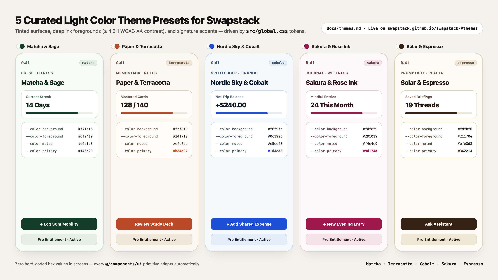
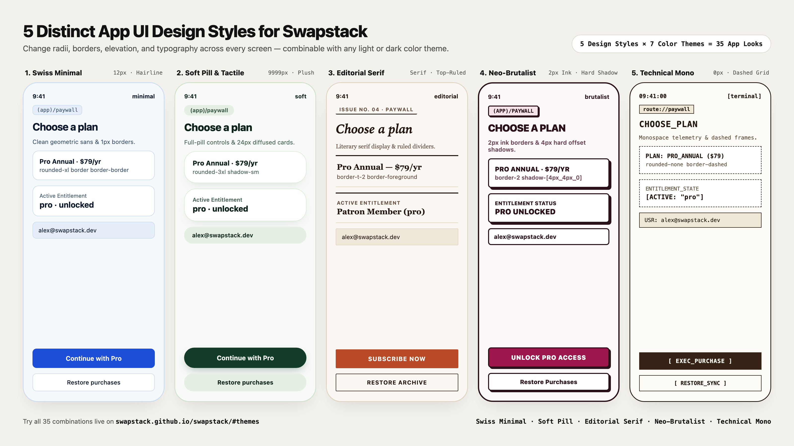

# Light Color Theme Presets

Swapstack's design system ([DESIGN.md](../DESIGN.md) and [`src/global.css`](../src/global.css)) is 100% token-driven. Changing the semantic surface, border, and primary action tokens rebrands every screen (`(auth)` and `(app)`) and UI primitive (`Button`, `Card`, `Input`, `Screen`, `Avatar`, `Toast`) automatically.

You can live-preview all of these palettes on the [Swapstack interactive website](https://swapstack.github.io/swapstack/#themes).



---

## How to Apply a Theme Preset

### Option A: Paste into `src/global.css`

Replace the `@variant light` block inside `src/global.css` (and update `neutral-900` if changing the primary button fill) with any preset below.

### Option B: One-Prompt AI Rebrand

Copy this prompt into Claude Code, Cursor, Antigravity, Copilot, or Codex:

```text
Apply the "<Theme Name>" light theme preset from `docs/themes.md` to this Swapstack app:
1. Update the semantic color tokens in `DESIGN.md`, `src/global.css`, and `src/components/ui/colors.js` using the preset hex values.
2. Ensure all text and muted-foreground combinations maintain >= 4.5:1 WCAG AA contrast in both light and dark modes.
3. Run `pnpm run lint`, `pnpm run type-check`, and `pnpm test`.
```

---

## 1. Matcha & Sage (Botanical Light)

A calm, organic palette ideal for wellness, habit trackers (**Pulse**), journaling, and mindfulness apps.

| Token | Hex | Role |
| --- | --- | --- |
| `background` | `#f7faf6` | Warm alabaster-sage canvas |
| `foreground` | `#0f2419` | Deep forest ink |
| `card` | `#ffffff` | Crisp elevated card surface |
| `muted` | `#e6efe3` | Soft sage input & badge fill |
| `muted-foreground` | `#3f5e4d` | Botanical slate secondary text |
| `border` | `#cfe0cb` | Crisp leaf-tinted hairline border |
| `primary` | `#143d29` | Deep forest primary button |
| `primary-foreground` | `#ffffff` | White button label |

```css
/* src/global.css */
@variant light {
  --color-background: #f7faf6;
  --color-foreground: #0f2419;
  --color-card: #ffffff;
  --color-card-foreground: #0f2419;
  --color-muted: #e6efe3;
  --color-muted-foreground: #3f5e4d;
  --color-border: #cfe0cb;
  --color-input: #cfe0cb;
  --color-ring: #143d29;
  --color-neutral-900: #143d29;
}
```

---

## 2. Warm Paper & Terracotta (Editorial Light)

A tactile, literary palette inspired by warm book paper and burnt sienna ink—great for notes, flashcards (**MemoStack**), reading, and recipe apps.

| Token | Hex | Role |
| --- | --- | --- |
| `background` | `#fbf8f3` | Unbleached warm paper canvas |
| `foreground` | `#241710` | Deep espresso-ink headings |
| `card` | `#fffdf9` | Warm ivory card surface |
| `muted` | `#efe7da` | Sand input & badge fill |
| `muted-foreground` | `#695244` | Warm umber secondary copy |
| `border` | `#dfd3c0` | Sandstone hairline divider |
| `primary` | `#b84a27` | Terracotta / burnt sienna CTA |
| `primary-foreground` | `#ffffff` | Crisp white button label |

```css
/* src/global.css */
@variant light {
  --color-background: #fbf8f3;
  --color-foreground: #241710;
  --color-card: #fffdf9;
  --color-card-foreground: #241710;
  --color-muted: #efe7da;
  --color-muted-foreground: #695244;
  --color-border: #dfd3c0;
  --color-input: #dfd3c0;
  --color-ring: #b84a27;
  --color-neutral-900: #b84a27;
}
```

---

## 3. Nordic Sky & Cobalt (Precision Light)

A high-clarity architectural blue palette suited for SaaS tools, AI assistants (**PromptBox**), fintech (**SplitLedger**), and developer utilities.

| Token | Hex | Role |
| --- | --- | --- |
| `background` | `#f6f9fc` | Cool Nordic ice canvas |
| `foreground` | `#0c192c` | Deep maritime navy text |
| `card` | `#ffffff` | Pure white card surface |
| `muted` | `#e5eef8` | Ice-tinted input & pill fill |
| `muted-foreground` | `#3b526e` | Steel-blue secondary text |
| `border` | `#cbdcf0` | Cool structural border |
| `primary` | `#1d4ed8` | Electric cobalt primary CTA |
| `primary-foreground` | `#ffffff` | White button label |

```css
/* src/global.css */
@variant light {
  --color-background: #f6f9fc;
  --color-foreground: #0c192c;
  --color-card: #ffffff;
  --color-card-foreground: #0c192c;
  --color-muted: #e5eef8;
  --color-muted-foreground: #3b526e;
  --color-border: #cbdcf0;
  --color-input: #cbdcf0;
  --color-ring: #1d4ed8;
  --color-neutral-900: #1d4ed8;
}
```

---

## 4. Sakura & Rose Ink (Soft Blush Light)

A refined blush canvas paired with high-contrast berry ink—ideal for creative studios, social clubs, lifestyle, and event apps.

| Token | Hex | Role |
| --- | --- | --- |
| `background` | `#fdf8f9` | Soft sakura-blush canvas |
| `foreground` | `#291019` | Deep wine-ink headings |
| `card` | `#ffffff` | Crisp white card surface |
| `muted` | `#f4e4e9` | Rose-mist input & pill fill |
| `muted-foreground` | `#6e4453` | Muted plum secondary copy |
| `border` | `#e8cdd6` | Blush hairline border |
| `primary` | `#9d174d` | Deep berry rose CTA |
| `primary-foreground` | `#ffffff` | White button label |

```css
/* src/global.css */
@variant light {
  --color-background: #fdf8f9;
  --color-foreground: #291019;
  --color-card: #ffffff;
  --color-card-foreground: #291019;
  --color-muted: #f4e4e9;
  --color-muted-foreground: #6e4453;
  --color-border: #e8cdd6;
  --color-input: #e8cdd6;
  --color-ring: #9d174d;
  --color-neutral-900: #9d174d;
}
```

---

## 5. Solar & Espresso (Warm Luxury Light)

A sunlit oat-and-ivory surface anchored by rich roasted espresso buttons—great for hospitality, travel, commerce, and personal finance apps.

| Token | Hex | Role |
| --- | --- | --- |
| `background` | `#fdfbf6` | Sunlit ivory canvas |
| `foreground` | `#21170e` | Dark roasted espresso ink |
| `card` | `#ffffff` | Pure white card surface |
| `muted` | `#efe8d8` | Warm oat input & badge fill |
| `muted-foreground` | `#63513f` | Toasted walnut secondary text |
| `border` | `#dfd4bc` | Warm linen border |
| `primary` | `#362214` | Rich espresso primary button |
| `primary-foreground` | `#fdfbf6` | Warm ivory button label |

```css
/* src/global.css */
@variant light {
  --color-background: #fdfbf6;
  --color-foreground: #21170e;
  --color-card: #ffffff;
  --color-card-foreground: #21170e;
  --color-muted: #efe8d8;
  --color-muted-foreground: #63513f;
  --color-border: #dfd4bc;
  --color-input: #dfd4bc;
  --color-ring: #362214;
  --color-neutral-900: #362214;
}
```

---

## 5 App UI Design Styles (Geometry, Borders & Typography)

Beyond color tokens, you can transform the visual personality of every screen by updating the geometry, border weight, shadow, and typography of Swapstack's UI primitives (`src/components/ui/card.tsx`, `button.tsx`, `input.tsx`, and `text.tsx`). Combine any of the **5 App UI Design Styles** below with any of the **7 Color Themes** above for **35 distinct app aesthetics**:



### Style 1: Swiss Minimal (`minimal` — Default)
- **Best for**: SaaS companions, productivity tools, developer utilities.
- **Typography**: `Inter` (`--font-sans: 'Inter'`), tight `-0.02em` heading tracking.
- **Primitive classes**:
  - `Card`: `rounded-xl border border-border bg-card p-4`
  - `Button`: `rounded-lg h-11 px-4 font-semibold`
  - `Input`: `rounded-lg h-11 px-3 border border-input bg-muted`

### Style 2: Soft Pill & Tactile (`soft`)
- **Best for**: Habit trackers (**Pulse**), wellness, meditation, consumer social apps.
- **Typography**: Rounded humanist sans (`Plus Jakarta Sans`), warm bold headings.
- **Primitive classes**:
  - `Card`: `rounded-3xl border border-border/60 bg-card p-5 shadow-sm`
  - `Button`: `rounded-full h-12 px-6 font-bold`
  - `Input`: `rounded-full h-12 px-5 border border-input bg-muted`

### Style 3: Editorial Serif (`editorial`)
- **Best for**: Reading apps, study decks (**MemoStack**), journaling, knowledge tools.
- **Typography**: High-contrast serif display headings (`Instrument Serif` / `Georgia`), uppercase tracked form labels (`uppercase tracking-widest text-xs font-bold`).
- **Primitive classes**:
  - `Card`: `rounded-none border-t-2 border-foreground border-b border-border bg-transparent py-4 px-1`
  - `Button`: `rounded-sm h-11 px-5 font-semibold uppercase tracking-wider`
  - `Input`: `rounded-sm h-11 px-3 border border-border bg-muted`

### Style 4: Neo-Brutalist (`brutalist`)
- **Best for**: Indie creator tools, expense splitters (**SplitLedger**), bold consumer fintech.
- **Typography**: Heavy geometric headings (`font-black uppercase tracking-tight`).
- **Primitive classes**:
  - `Card`: `rounded-md border-2 border-foreground bg-card p-4 shadow-[4px_4px_0px_0px_var(--color-foreground)]`
  - `Button`: `rounded-md h-11 px-5 border-2 border-foreground font-extrabold uppercase tracking-wider shadow-[3px_3px_0px_0px_var(--color-foreground)]`
  - `Input`: `rounded-md h-11 px-3 border-2 border-foreground bg-card font-semibold`

### Style 5: Technical Mono (`terminal`)
- **Best for**: AI assistants (**PromptBox**), telemetry dashboards, developer & crypto tools.
- **Typography**: Full monospace (`JetBrains Mono` / `SF Mono`) across headings, labels, inputs, and buttons.
- **Primitive classes**:
  - `Card`: `rounded-none border border-dashed border-foreground/70 bg-card p-3.5 font-mono`
  - `Button`: `rounded-none h-10 px-4 font-mono uppercase tracking-wider text-xs font-bold`
  - `Input`: `rounded-none h-10 px-3 border border-foreground/60 bg-muted font-mono text-xs`

